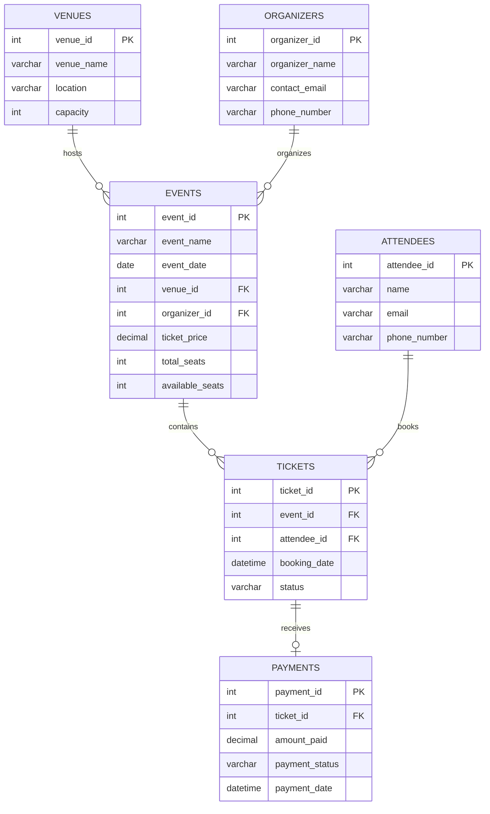

 
<!-- ========================================= -->
<!-- SMART EVENT MANAGEMENT SYSTEM - README -->
<!-- ========================================= -->

<div align="center">


<br/>


<br/>


</div>

---

## ✨ About The Project

**Smart Event Management System** is a relational database management project developed using MySQL.

It provides a structured way to manage event information, venues, organizers, attendees, ticket bookings, and payment transactions.

The project focuses on practical SQL implementation, database relationships, data manipulation, reporting, and advanced query techniques.

> **Project Goal:** Build a structured database and transform event-related data into meaningful information using SQL.

---

## 🎯 Project Highlights

<table>
<tr>
<td width="50%">

### 🏢 Venue Management
Store venue names, locations, and seating capacities.

</td>
<td width="50%">

### 📅 Event Management
Manage event names, dates, ticket prices, and available seats.

</td>
</tr>
<tr>
<td width="50%">

### 👥 Attendee Management
Maintain attendee details and contact information.

</td>
<td width="50%">

### 🎫 Ticket Management
Manage ticket bookings and booking statuses.

</td>
</tr>
<tr>
<td width="50%">

### 💳 Payment Management
Store payment amounts, dates, and transaction statuses.

</td>
<td width="50%">

### 📊 Data Analysis
Analyze event revenue, ticket prices, and booking information.

</td>
</tr>
</table>

---

## 🛠️ Technology Stack

<div align="center">

| Technology | Usage |
|:---:|:---|
|  | MySQL Database |
|  | Git Version Control |
|  | GitHub Repository |
|  | SQL Development |
|  | MySQL Workbench |

</div>

---

## 🗄️ Database Architecture

**Database Name:** `smart_event_management_system`

The database consists of six interconnected tables.

| Table | Description | Primary Key |
|:---|:---|:---|
| `venues` | Venue information | venue_id |
| `organizers` | Organizer information | organizer_id |
| `attendees` | Attendee information | attendee_id |
| `events` | Event details | event_id |
| `tickets` | Ticket booking details | ticket_id |
| `payments` | Payment transactions | payment_id |

### 🔗 Entity Relationship Diagram



### Database Relationships

- One venue can host multiple events.
- One organizer can organize multiple events.
- One event can have multiple tickets.
- One attendee can book multiple tickets.
- One ticket can have one payment record.

---

## ⚡ SQL Concepts & Implementation

<details>
<summary><b>01. Database Design & Constraints</b></summary>

- CREATE DATABASE
- CREATE TABLE
- PRIMARY KEY
- FOREIGN KEY
- AUTO_INCREMENT
- UNIQUE

</details>

<details>
<summary><b>02. CRUD Operations</b></summary>

- INSERT INTO
- SELECT
- UPDATE
- DELETE

</details>

<details>
<summary><b>03. SQL Clauses & Operators</b></summary>

- WHERE
- GROUP BY
- HAVING
- ORDER BY
- LIMIT
- AND
- OR
- NOT

</details>

<details>
<summary><b>04. Aggregate Functions</b></summary>

- SUM()
- AVG()
- MAX()
- MIN()
- COUNT()

</details>

<details>
<summary><b>05. SQL Joins</b></summary>

- INNER JOIN
- LEFT JOIN
- RIGHT JOIN
- FULL OUTER JOIN equivalent using UNION

</details>

<details>
<summary><b>06. Subqueries</b></summary>

- Nested SELECT
- IN Operator
- Aggregate Subqueries

</details>

<details>
<summary><b>07. Date & Time Functions</b></summary>

- MONTH()
- YEAR()
- DAY()
- DATEDIFF()
- CURDATE()
- DATE_FORMAT()

</details>

<details>
<summary><b>08. String Functions</b></summary>

- UPPER()
- LOWER()
- TRIM()
- COALESCE()
- LENGTH()

</details>

<details>
<summary><b>09. Window Functions</b></summary>

- RANK()
- SUM() OVER()
- COUNT() OVER()
- PARTITION BY
- ORDER BY

</details>

<details>
<summary><b>10. CASE Expressions</b></summary>

- Event Demand Classification
- Payment Status Classification
- Conditional Logic

</details>

---

## 💻 Practical SQL Examples

### 1. Total Revenue Analysis

```sql
SELECT
    SUM(amount_paid) AS total_revenue
FROM payments;
```

### 2. Event-Wise Revenue

```sql
SELECT
    e.event_name,
    SUM(p.amount_paid) AS total_revenue
FROM events e
JOIN tickets t
    ON e.event_id = t.event_id
JOIN payments p
    ON t.ticket_id = p.ticket_id
GROUP BY e.event_id, e.event_name
ORDER BY total_revenue DESC;
```

### 3. Find Events Above Average Ticket Price

```sql
SELECT
    event_name,
    ticket_price
FROM events
WHERE ticket_price > (
    SELECT AVG(ticket_price)
    FROM events
);
```

### 4. Rank Events by Revenue

```sql
SELECT
    event_name,
    total_revenue,
    RANK() OVER (
        ORDER BY total_revenue DESC
    ) AS event_rank
FROM (
    SELECT
        e.event_name,
        SUM(p.amount_paid) AS total_revenue
    FROM events e
    JOIN tickets t
        ON e.event_id = t.event_id
    JOIN payments p
        ON t.ticket_id = p.ticket_id
    GROUP BY e.event_id, e.event_name
) AS revenue_data;
```

### 5. Event Demand Classification

```sql
SELECT
    event_name,
    CASE
        WHEN available_seats < total_seats * 0.20
            THEN 'High Demand'

        WHEN available_seats <= total_seats * 0.50
            THEN 'Moderate Demand'

        ELSE 'Low Demand'
    END AS event_demand
FROM events;
```

---

## 🚀 Installation & Execution

### Prerequisites

- MySQL Server 8.0 or newer
- MySQL Workbench
- Git

### Step 1 — Clone Repository

```bash
git clone <YOUR-GITHUB-REPOSITORY-URL>
```

### Step 2 — Open Project

Open the cloned project folder in your system.

### Step 3 — Open MySQL Workbench

Connect to your MySQL Server.

### Step 4 — Execute SQL File

Open:

`smart_event_management_system.sql`

Execute the complete SQL script from top to bottom.

### Step 5 — Verify Database

```sql
SHOW DATABASES;

USE smart_event_management_system;

SHOW TABLES;
```

### Step 6 — Check Records

```sql
SELECT * FROM venues;
SELECT * FROM organizers;
SELECT * FROM attendees;
SELECT * FROM events;
SELECT * FROM tickets;
SELECT * FROM payments;
```

---

## 📁 Project Structure

```text
Smart-Event-Management-System/
│
├── smart_event_management_system.sql
│
└── README.md
```

---

## 📈 Key Learning Outcomes

Through this project, I gained practical experience in:

- Designing relational database structures.
- Creating and managing interconnected tables.
- Understanding primary and foreign key constraints.
- Performing CRUD operations.
- Writing complex SQL JOIN queries.
- Solving real-world problems using subqueries.
- Performing data analysis using aggregate functions.
- Working with date and string functions.
- Applying window functions for ranking and running totals.
- Creating conditional reports using CASE expressions.

---

## 🔮 Future Enhancements

- [ ] Implement Stored Procedures.
- [ ] Add database Triggers for seat management.
- [ ] Create Views for event revenue reports.
- [ ] Implement transaction management.
- [ ] Add more realistic sample data.
- [ ] Build a frontend application connected to MySQL.

---

## 👨‍💻 Developer

<div align="center">


### Shrey Anghan

**Aspiring SQL & Database Developer**

Passionate about learning database management, SQL development, and solving real-world problems through technology.

<br/>

<a href="https://github.com/anghanshrey">

</a>

<a href="https://www.linkedin.com/">

</a>

</div>

---

<div align="center">

### ⭐ If you like this project, give it a star!


**BUILD • LEARN • PRACTICE • IMPROVE**

</div>
